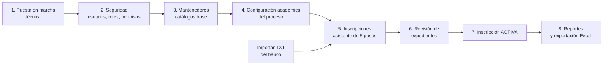
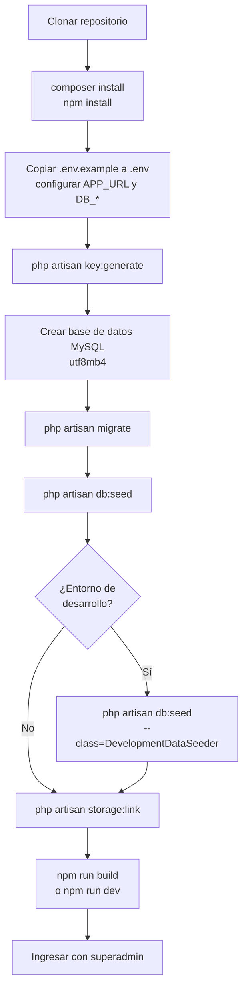
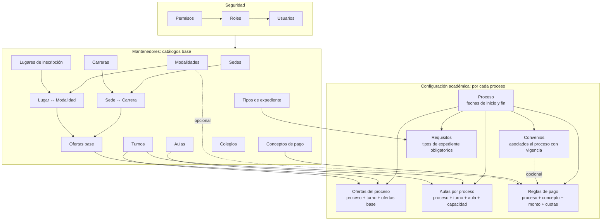
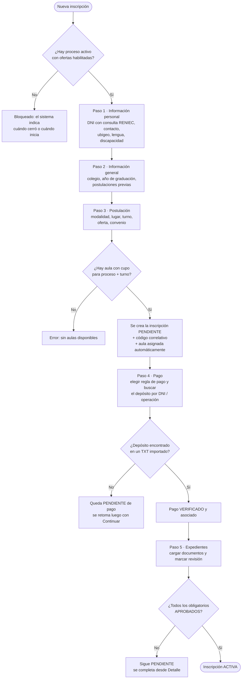
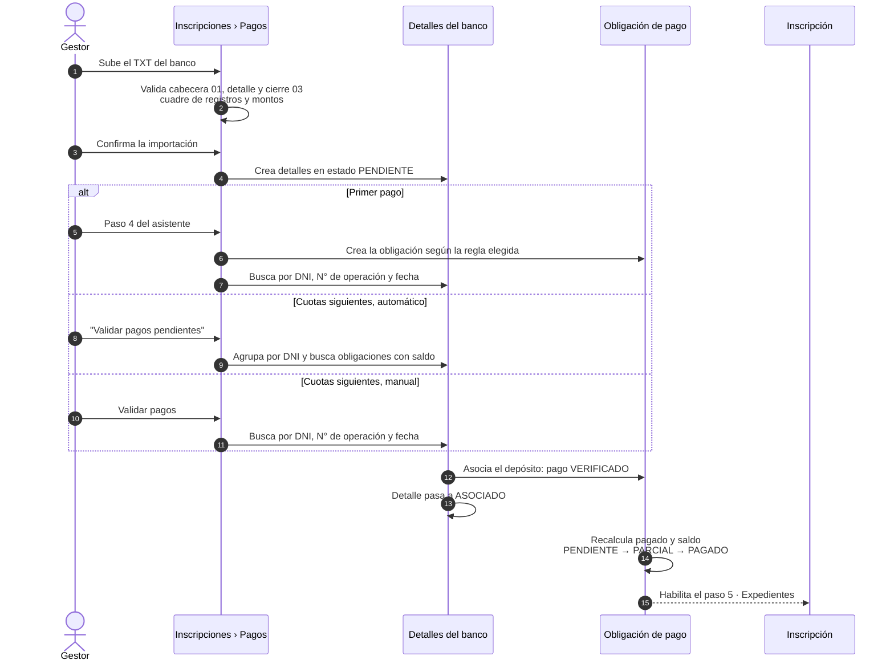
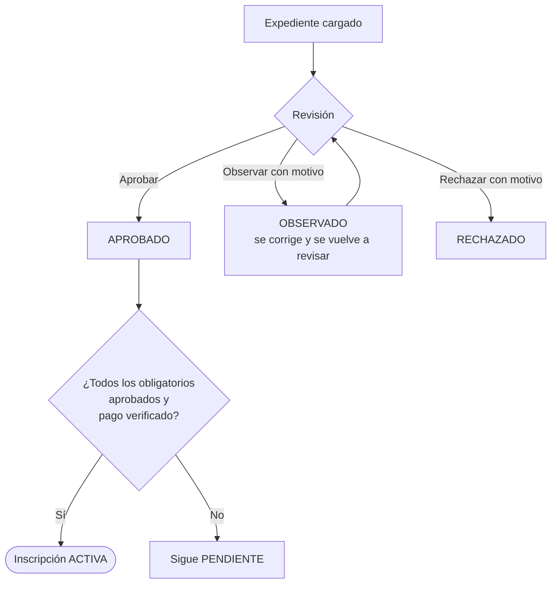
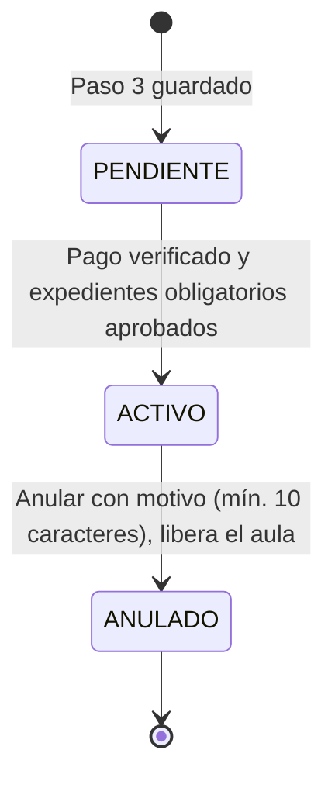
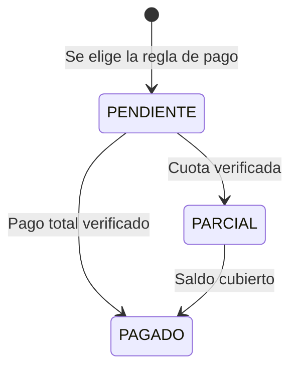
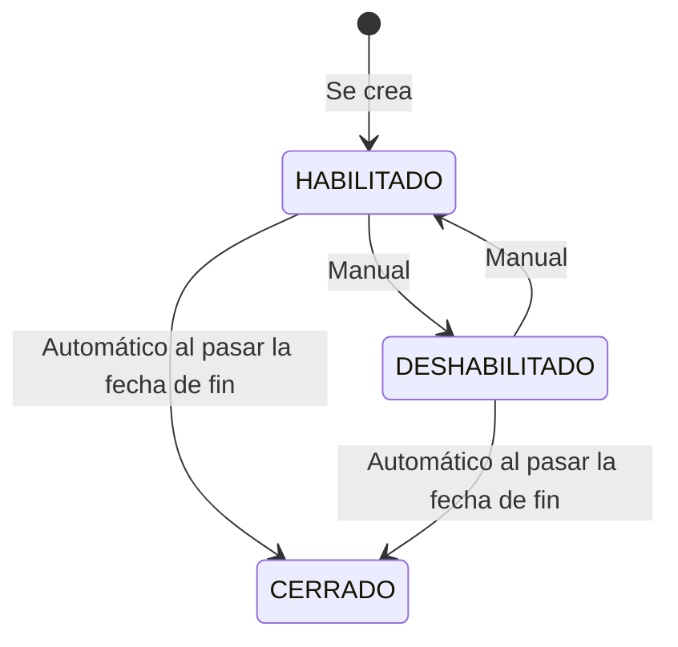

# UNIVERSIDAD NACIONAL DE UCAYALI
## CENTRO PREUNIVERSITARIO - CEPRE UNU
### FLUJO DE PROCESOS DEL SISTEMA DE INSCRIPCIONES

Este documento resume, con diagramas, **qué se tiene que hacer y en qué orden** para que el sistema funcione de punta a punta: desde la puesta en marcha hasta que una inscripción queda activa y aparece en los reportes.

Complementa a:

- `MANUAL_INSTALACION_CEPRE.md`: detalle técnico de instalación.
- `MANUAL_USUARIO_CEPRE.md`: detalle pantalla por pantalla.

> Los diagramas usan Mermaid. Se ven renderizados en GitHub, GitLab, VS Code (con vista previa Markdown) y la mayoría de editores modernos.

---

## Índice

1. Mapa general
2. Puesta en marcha técnica
3. Configuración: orden obligatorio
4. Checklist antes de abrir inscripciones
5. Flujo de una inscripción (asistente de 5 pasos)
6. Flujo de pagos con el TXT del banco
7. Expedientes y activación de la inscripción
8. Estados del sistema
9. Reglas automáticas que conviene conocer
10. Observaciones y mejoras detectadas

---

## 1. Mapa general

| Etapa | Responsable | Frecuencia |
|---|---|---|
| Puesta en marcha técnica | Soporte TI | Una vez por servidor |
| Seguridad | SuperAdministrador | Al inicio y cuando ingresa personal |
| Mantenedores | SuperAdministrador | Al inicio; se actualiza ocasionalmente |
| Configuración académica | SuperAdministrador | **Cada nuevo proceso de inscripción** |
| Importar TXT del banco | Gestor de Inscripciones | Diario durante el proceso |
| Inscripciones y expedientes | Gestor de Inscripciones | Diario durante el proceso |
| Reportes | Ambos perfiles | A demanda |

---

## 2. Puesta en marcha técnica

Puntos clave:

- `db:seed` carga los catálogos base (ubigeo, países, colegios, tipos de documento, carreras, sedes, modalidades, etc.), los permisos y el usuario inicial `superadmin`.
- `DevelopmentDataSeeder` agrega datos de demostración (proceso, ofertas, inscripciones, usuario `gestor.cepre`). **No usar en producción.**
- Las sesiones y la caché deben usar `file` o `redis` (ver sección 10.1).
- En producción la cola usa `QUEUE_CONNECTION=database` y requiere `queue:work` (ver manual de instalación, sección 14).

---

## 3. Configuración: orden obligatorio

Cada pantalla depende de datos creados en pantallas anteriores. Si se salta un paso, el siguiente no tendrá opciones para seleccionar.

### 3.1. Paso a paso de configuración de un nuevo proceso

| # | Menú | Qué registrar | Depende de |
|---|---|---|---|
| 1 | Configuración Académica › Procesos | Nombre, fecha/hora de inicio y fin | — |
| 2 | Configuración Académica › Ofertas › Asignar | Proceso, turno y las ofertas base que se abren | Proceso, Turnos, Ofertas base |
| 3 | Configuración Académica › Aulas › Asignar | Proceso, turno, aula y capacidad | Proceso, Turnos, Aulas |
| 4 | Configuración Académica › Convenios *(opcional)* | Convenio, beneficio y vigencia dentro del proceso | Proceso |
| 5 | Configuración Académica › Reglas de Pago | Concepto, monto, cuotas, vigencia; opcionalmente modalidad o convenio | Proceso, Conceptos de pago |
| 6 | Configuración Académica › Requisitos | Tipos de expediente y cuáles son obligatorios | Proceso, Tipos de expediente |

> **Importante:** cada combinación **proceso + turno** ofertada en el paso 2 necesita al menos un aula con capacidad en el paso 3. Si no, el asistente no podrá guardar la postulación.

---

## 4. Checklist antes de abrir inscripciones

- [ ] Hay un **proceso HABILITADO** cuya fecha de inicio ya pasó y cuya fecha de fin no ha llegado.
- [ ] El proceso tiene al menos **una oferta HABILITADA**.
- [ ] Cada turno ofertado tiene **aulas habilitadas con capacidad** suficiente.
- [ ] Existe al menos una **regla de pago habilitada y vigente hoy** para el proceso (general, o por modalidad/convenio).
- [ ] Existen **requisitos de expediente** y al menos uno está marcado como **obligatorio**.
- [ ] Los **convenios**, si aplican, están vigentes en las fechas del proceso.
- [ ] El personal operativo tiene el rol **Gestor de Inscripciones CEPRE**.
- [ ] Se cuenta con el **TXT del banco** para conciliar los pagos.

---

## 5. Flujo de una inscripción (asistente de 5 pasos)

Ruta: **Inscripciones › Nueva inscripción**. Un borrador puede retomarse con **Continuar** desde el listado.

Notas:

- El aula se asigna sola, recorriendo las aulas del proceso y turno por lugar, piso y nombre, y tomando la primera con cupo. Luego puede cambiarse manualmente desde el listado (**Asignar aula**).
- Un postulante no puede pasar al paso 5 sin un pago verificado.

---

## 6. Flujo de pagos con el TXT del banco

El sistema **no registra pagos manualmente**: todo pago proviene de un archivo TXT del banco importado previamente.

La obligación de pago se crea en el **paso 4 del asistente**, así que el primer pago siempre se asocia ahí. "Validar pagos pendientes" y la pantalla "Validar pagos" solo encuentran obligaciones que ya existen, es decir, sirven para las cuotas siguientes.

Validaciones del monto:

- El DNI del depósito debe coincidir con el del postulante.
- El monto no puede superar el saldo pendiente.
- Si la regla **no permite cuotas**, el primer pago debe cubrir el total.
- Si permite cuotas, la primera debe alcanzar el **monto mínimo de primera cuota**.

---

## 7. Expedientes y activación de la inscripción

Ruta: **Inscripciones › Detalle** (o paso 5 del asistente).

---

## 8. Estados del sistema

### 8.1. Inscripción

### 8.2. Obligación de pago

### 8.3. Proceso

### 8.4. Resumen de estados

| Entidad | Estados |
|---|---|
| Inscripción | PENDIENTE · ACTIVO · ANULADO |
| Obligación de pago | PENDIENTE · PARCIAL · PAGADO · EXONERADO · ANULADO |
| Validación de pago | PENDIENTE · VERIFICADO · RECHAZADO |
| Detalle del banco | PENDIENTE · ASOCIADO · OBSERVADO |
| Expediente | PENDIENTE · APROBADO · OBSERVADO · RECHAZADO |
| Proceso | HABILITADO · DESHABILITADO · CERRADO |

---

## 9. Reglas automáticas que conviene conocer

1. **Cierre de procesos:** cada vez que se resuelve el proceso activo, los procesos cuya fecha de fin ya pasó se marcan como `CERRADO`.
2. **Un solo proceso activo:** si hay varios habilitados en rango de fechas, se usa el de fecha de inicio más antigua.
3. **Código de inscripción:** `AA` + `N° de periodo` + correlativo de 4 dígitos por proceso. Las inscripciones eliminadas cuentan, para no reutilizar códigos.
4. **Capacidad de aulas:** se cuentan todas las inscripciones no anuladas del aula; al anular, el cupo se libera.
5. **Vigencias:** reglas de pago y convenios se validan contra la fecha del día; si vencen mientras un borrador está a medio camino, el asistente lo bloquea con un mensaje.

---

## 10. Observaciones y mejoras detectadas

Encontradas al contrastar el código con los manuales existentes.

### 10.1. Técnicas

| # | Observación | Impacto | Sugerencia |
|---|---|---|---|
| 1 | `.env.example` usa `SESSION_DRIVER=database` y `CACHE_STORE=database`, pero **no existen migraciones** para las tablas `sessions` ni `cache`. | Instalación nueva da error 500. | Crear las migraciones (`php artisan make:session-table`, `make:cache-table`) o cambiar el ejemplo a `file`. |
| 2 | El manual de instalación asume Windows + Herd Pro. | Equipos macOS o Herd gratuito no tienen guía. | Añadir nota para macOS / MySQL externo (DBngin, Homebrew). |

### 10.2. Funcionales

| # | Observación | Impacto | Sugerencia |
|---|---|---|---|
| 3 | Si un proceso **no tiene requisitos obligatorios**, ninguna inscripción llega a `ACTIVO`. | Inscripciones quedan pendientes para siempre. | Validarlo en el checklist del proceso o activar solo con el pago cuando no hay requisitos. |
| 4 | El estado `EXONERADO` se consulta pero **ningún flujo lo asigna**. | Un convenio de exoneración total no tiene cómo pasar el paso 4. | Definir el flujo de exoneración (por ejemplo, regla de pago con monto 0 que marque la obligación como exonerada). |
| 5 | El descuento de un convenio **no se calcula automáticamente**; se aplica creando una regla de pago asociada a ese convenio. | Riesgo de olvidar crear la regla. | Documentarlo en el manual o calcular el monto desde el convenio. |
| 6 | Solo se pueden anular inscripciones `ACTIVO`. | Los borradores `PENDIENTE` abandonados ocupan aula indefinidamente. | Permitir anular pendientes o liberar su aula al cerrar el proceso. |

### 10.3. Documentación

| # | Observación | Sugerencia |
|---|---|---|
| 7 | `MANUAL_USUARIO_CEPRE.md` menciona el submódulo **Semestres**, que ya no existe; el proceso se crea directamente con sus fechas. | Retirar la sección 13.1 y ajustar las secciones 7, 8 y 19. |
| 8 | El manual de usuario no documenta los nuevos mantenedores: **Carreras, Sedes, Modalidades, Lugares de inscripción, Ofertas base, Turnos y Conceptos de pago**. | Agregar una sección por cada uno, siguiendo el orden de la sección 3 de este documento. |
| 9 | El manual de usuario no explica la **importación del TXT del banco**, que es la base de la validación de pagos. | Agregar el flujo de la sección 6. |
| 10 | En el asistente, el paso 3 se describe como "Proceso, oferta y colegio", pero el colegio se registra en el paso 2. | Cambiar la descripción del paso 3 en `inscripcion-crear.php` a "Proceso, oferta y convenio". |

> Las observaciones 7, 8 y 9 ya se corrigieron en la versión 1.1 de `MANUAL_USUARIO_CEPRE.md`.
