# UNIVERSIDAD NACIONAL DE UCAYALI
## CENTRO PREUNIVERSITARIO - CEPRE UNU
### FLUJO DE PROCESOS DEL SISTEMA DE INSCRIPCIONES

Este documento resume con diagramas **qué se hace y en qué orden** para que el sistema funcione de punta a punta. Empieza en la puesta en marcha y termina cuando el postulante tiene su ficha y su carnet y aparece en los reportes.

> **Actualizado en noviembre de 2026** para la nueva interfaz (Inertia + React): nombres de botones y menús, avisos del paso de pago, DNI automático, lengua materna CASTELLANO, aviso de pago sin inscripción en la consulta del portal, y el seguimiento con gráficos en el inicio y en el reporte.

Complementa a:

- `MANUAL_INSTALACION_CEPRE.md`: detalle técnico de instalación y actualización.
- `MANUAL_USUARIO_CEPRE.md`: detalle pantalla por pantalla.

> Los diagramas usan Mermaid. Se ven renderizados en GitHub, GitLab, VS Code (con vista previa Markdown) y la mayoría de editores modernos.

---

## Índice

1. Mapa general
2. Puesta en marcha técnica
3. Configuración: orden obligatorio
4. Checklist antes de abrir inscripciones
5. Pagos: primero el pago
6. Flujo de una inscripción (asistente de 4 pasos)
7. Inscripción en línea desde el portal del postulante
8. Fotos, ficha de matrícula y carnet
9. Seguimiento: inicio y reporte de inscripciones
10. Estados del sistema
11. Reglas automáticas que conviene conocer
12. Observaciones pendientes

---

## 1. Mapa general

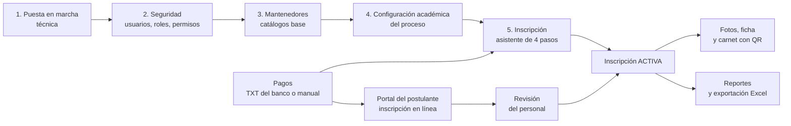

| Etapa | Responsable | Frecuencia |
|---|---|---|
| Puesta en marcha técnica | Soporte TI | Una vez por servidor |
| Seguridad | SuperAdministrador | Al inicio y cuando ingresa personal |
| Mantenedores | SuperAdministrador | Al inicio; se actualiza ocasionalmente |
| Configuración académica | SuperAdministrador | **Cada nuevo proceso** |
| Pagos (TXT del banco y pagos manuales) | Gestor de Inscripciones | Diario durante el proceso |
| Inscripciones y revisión de las del portal | Gestor de Inscripciones | Diario durante el proceso |
| Fotos, ficha y carnet | Gestor de Inscripciones | Durante el proceso |
| Reportes y códigos de Admisión | Ambos perfiles | A demanda y al final del proceso |

---

## 2. Puesta en marcha técnica

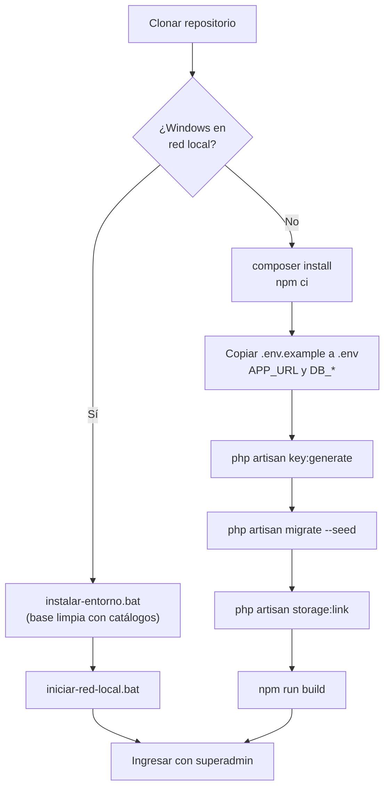

Puntos clave:

- Requiere **PHP 8.4 o superior** con las extensiones `gd`, `zip`, `mbstring`, `dom`, `fileinfo` y `pdo_mysql`, y **Node.js 20.19+ o 22.12+** (lo pide Vite 8). Los scripts de Windows verifican ambas versiones.
- `npm run build` también usa PHP: genera las rutas del frontend con Wayfinder antes de compilar, por eso PHP debe estar en el PATH.
- `db:seed` carga los catálogos base (ubigeo, países, colegios, tipos de documento, carreras, sedes, modalidades, turnos, conceptos de pago), los permisos, el rol `ADMINISTRADOR` y el usuario `superadmin`.
- El rol `ADMINISTRADOR` tiene acceso total; los demás roles necesitan que se les asignen los permisos.
- Para **actualizar** una instalación con datos no se usa `instalar-entorno` (borra la base): en Windows se baja el código con `git pull origin main` y se ejecuta `actualizar-sistema.bat`; en el servidor de producción (DOM Cloud) el despliegue se hace solo al subir a `main`, con `migrate`, `npm ci`, `npm run build` y la limpieza de cachés (ver el manual de instalación).

---

## 3. Configuración: orden obligatorio

Cada pantalla depende de datos creados en pantallas anteriores. Si se salta un paso, el siguiente no tendrá opciones para seleccionar.

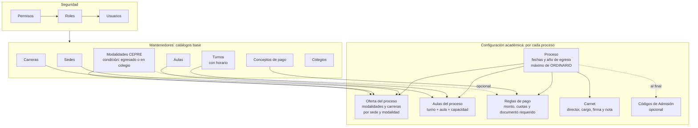

### 3.1. Paso a paso de configuración de un nuevo proceso

| # | Menú | Qué registrar | Depende de |
|---|---|---|---|
| 1 | Configuración académica › Procesos | Nombre con el periodo en romanos (por ejemplo `2027-I`), fecha y hora de inicio y fin, y el **año de egreso máximo para ORDINARIO** | — |
| 2 | Configuración académica › Oferta del proceso | Modalidades CEPRE habilitadas y carreras habilitadas en cada sede para cada modalidad | Proceso, Sedes, Carreras, Modalidades |
| 3 | Configuración académica › Aulas por proceso › Asignar aulas | Turno, aula y capacidad | Proceso, Turnos, Aulas |
| 4 | Configuración académica › Reglas de pago | Concepto, monto total, cuotas y monto mínimo de la primera, documento requerido (por ejemplo, N° de resolución de beca), vigencia y, si aplica, modalidad | Proceso, Conceptos de pago |
| 5 | Configuración académica › Carnet | Nombre y cargo del director, imagen de firma y sello, nota del carnet | — |
| 6 | Configuración académica › Códigos de Admisión *(al final, opcional)* | Códigos que entrega Admisión por sede, modalidad y carrera; se registran a mano o con la plantilla Excel (`Descargar plantilla` / `Cargar plantilla`) | Proceso con oferta |

Ejemplos de reglas de pago, como en el sistema anterior:

| Modalidad de pago | Monto mínimo para inscribir | Documento requerido |
|---|---|---|
| Cuota única | S/ 500 | — |
| Fraccionado en 2 cuotas | S/ 275 (suma de pagos del DNI) | — |
| Parentesco UNU | S/ 0 | N° de constancia de RRHH |
| Beca académica | S/ 50 (libros) | N° de resolución |
| Media beca | S/ 250 | N° de resolución |

> **Importante:** cada turno en el que se inscribe necesita al menos un aula habilitada con capacidad (paso 3). El asistente solo ofrece los turnos que tienen aulas.

---

## 4. Checklist antes de abrir inscripciones

- [ ] Hay un **proceso HABILITADO** cuya fecha de inicio ya pasó y cuya fecha de fin no ha llegado.
- [ ] El proceso tiene el **año de egreso máximo para ORDINARIO** correcto (por ejemplo, en el proceso 2027-I: hasta 2025 es ORDINARIO y desde 2026 es EXTRAORDINARIO O RESERVA).
- [ ] La **oferta del proceso** tiene habilitadas una modalidad para egresados y otra para quienes están en el colegio, y las carreras de cada sede.
- [ ] Cada turno tiene **aulas habilitadas con capacidad** suficiente.
- [ ] Hay **reglas de pago habilitadas y vigentes hoy** para el proceso.
- [ ] El **carnet** tiene configurados el director, el cargo y la firma.
- [ ] El personal operativo tiene un rol con los permisos de inscripciones, pagos y fotos.
- [ ] Se cuenta con el **TXT del banco** del día para cargar los pagos.

---

## 5. Pagos: primero el pago

Nadie se inscribe sin un pago previo. Cada pago queda **LIBRE** hasta que se usa en una inscripción; entonces pasa a **REGISTRADO** y ya no se puede volver a usar.

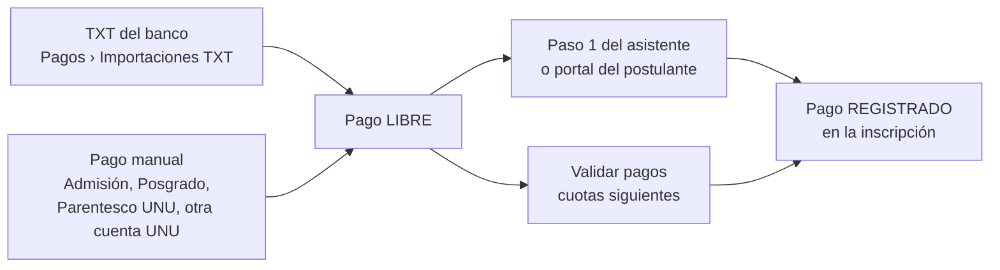

- **TXT del banco:** en `Inscripciones › Pagos`, botón **Importaciones TXT** y luego **Importar TXT** (recaudación BBVA). El sistema muestra la **Revisión del TXT bancario** (cabecera, totales, duplicados y observaciones) y, si todo cuadra, se usa **Confirmar importación**. Se crea un pago LIBRE por cada depósito.
- **Pago manual:** en `Inscripciones › Pagos`, botón **Registrar pago**, con la ubicación (ADMISIÓN, POSGRADO, PARENTESCO UNU u OTRA CUENTA UNU), el DNI, el N° de operación y el monto.
- **Cuotas siguientes:** en la lista de importaciones, la acción **Asociar pendientes** asocia automáticamente los pagos de quienes ya tienen saldo. También se puede hacer uno por uno en `Inscripciones › Validar pagos` (buscando el pago por DNI, operación y fecha, que el sistema valida antes de buscar).

Validaciones:

- El DNI del pago debe ser el del postulante.
- Se aceptan varios pagos del mismo DNI; se suman para llegar al mínimo de la regla.
- Se acepta pagar de más (por ejemplo, S/ 501 sobre S/ 500), pero no seguir pagando una obligación ya cubierta.
- Si la regla pide un documento (resolución o constancia), es obligatorio ingresarlo.

---

## 6. Flujo de una inscripción (asistente de 4 pasos)

Ruta: **Inscripciones › Nueva inscripción**.

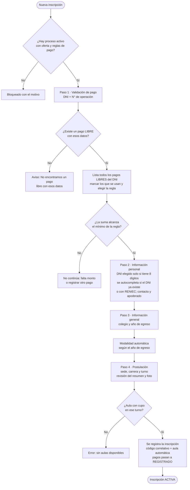

Notas:

- **Pago no encontrado:** si no hay un pago LIBRE con ese DNI y número de operación, el asistente muestra un aviso con qué revisar (TXT cargado, pago manual registrado, pago no usado antes). Si lo hay, lista **todos** los pagos libres del DNI, con el buscado ya marcado.
- **Tipo de documento:** al validar el pago, si el número tiene 8 dígitos se elige **DNI** automáticamente; con otra longitud el usuario elige el tipo (por ejemplo, carné de extranjería).
- **Lengua materna:** `CASTELLANO`, `NATIVA` (pide la lengua nativa) o `EXTRANJERA` (pide la lengua extranjera). Un postulante mestizo que habla castellano marca `MESTIZO` y `CASTELLANO`.
- **Validación:** todos los datos los valida el servidor; los campos con error se marcan en rojo con su mensaje.
- **Modalidad automática:** si el año de egreso es menor o igual al máximo del proceso, el postulante es egresado (ORDINARIO); si es mayor, está en el colegio (EXTRAORDINARIO O RESERVA). Se toma la modalidad CEPRE habilitada en el proceso para esa condición.
- **Activación:** la inscripción queda ACTIVA en cuanto lo pagado alcanza el mínimo de la regla. Como el paso 1 ya lo exige, normalmente queda activa al terminar.
- **Duplicados:** si el postulante ya tiene una inscripción en el mismo proceso, el sistema avisa y el personal decide si continuar.
- **Aula:** se asigna sola, recorriendo las aulas del turno por lugar, piso y nombre, y tomando la primera con cupo. Puede cambiarse desde el menú de la fila en el listado (**Asignar aula**).

---

## 7. Inscripción en línea desde el portal del postulante

El postulante entra sin usuario a `/postulante`. Desde ahí puede inscribirse o consultar su inscripción.

```mermaid
sequenceDiagram
    autonumber
    actor P as Postulante
    participant W as Portal /postulante
    participant S as Sistema
    actor G as Gestor

    P->>W: DNI + N° de operación del voucher
    W->>S: Busca pagos LIBRES de ese DNI
    alt No hay pago libre con esos datos
        S-->>W: Aviso: revisar el voucher o volver más tarde
    else Hay pagos libres
        S-->>W: Pagos encontrados (DNI elegido solo si tiene 8 dígitos)
    end
    P->>W: Completa los pasos 2 a 4 (sin subir foto)
    W->>S: Registra la inscripción EN REVISIÓN
    S-->>P: Código de inscripción
    G->>S: Inscripciones › Ver solo en revisión › Aprobar revisión
    S->>S: Si el pago alcanza el mínimo: ACTIVA
    P->>W: Consulta con DNI + N° de operación
    alt Pagó pero no terminó de inscribirse
        W-->>P: Aviso "Aún no completa su inscripción" + botón Inscribirme
    else Tiene inscripción
        W-->>P: Estado, aula y ficha; carnet si está ACTIVA
    end
```

Diferencias con el asistente del personal:

- El número de documento queda fijo (es el del pago): solo se usan pagos y datos de ese DNI. El tipo de documento se elige solo si tiene 8 dígitos y se puede cambiar.
- No se permite una segunda inscripción en el mismo proceso.
- No se sube foto; se toma en el CEPRE-UNU.
- La inscripción queda **EN REVISIÓN** hasta que un gestor con el permiso de cambiar el estado la apruebe o la anule.
- Las descargas de la ficha y el carnet usan enlaces firmados que vencen en 60 minutos.
- Hay un límite de intentos por minuto para evitar abusos.

---

## 8. Fotos, ficha de matrícula y carnet

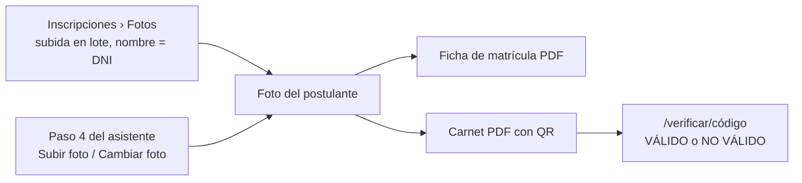

- **Fotos:** se guardan por DNI (sirven para todos los procesos), recortadas a 300 × 400 px. Se suben en lote con **Subir fotos** y se exportan con **Descargar ZIP** por proceso para la imprenta. La foto también aparece en el listado de inscripciones y en las últimas inscripciones del inicio; sin foto se muestran las iniciales.
- **Ficha de matrícula:** datos del postulante, del colegio, de la postulación y la tabla de pagos, con espacio para firmas. Se abre desde el menú de la fila (**Ficha (PDF)**) o desde el detalle (**Ficha**).
- **Carnet:** solo para inscripciones ACTIVAS. Se genera uno por uno (**Carnet (PDF)** o **Carnet** en el detalle) o en lote con los filtros del listado (**Carnets**).
- **Verificación:** el QR del carnet lleva a una página pública que muestra el nombre, el DNI enmascarado y si la inscripción es **VÁLIDA** (ACTIVA) o **NO VÁLIDA** (anulada o pendiente).

---

## 9. Seguimiento: inicio y reporte de inscripciones

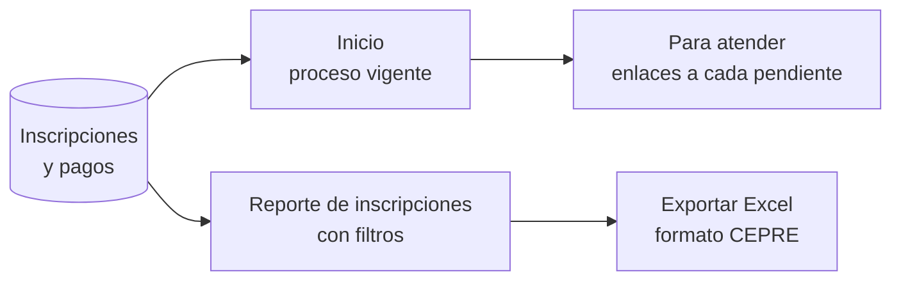

- **Inicio:** muestra el proceso vigente con el avance del periodo y los días que faltan, los inscritos, las inscripciones y pagos validados de hoy, las activas, las que están en revisión, las que tienen saldo y lo **recaudado** frente a lo esperado. Tiene gráficos de inscripciones por día (últimos 14 días), estado de las inscripciones, carreras con más inscritos, estado del pago, turno y sede, la **ocupación de aulas** por turno y la lista **Para atender** (inscripciones en línea por aprobar, pagos por regularizar, inscripciones activas sin aula y pagos del banco sin usar), cada una con su enlace.
- **Reporte de inscripciones:** con los mismos filtros que el Excel (proceso, modalidad, sede, turno y estado) muestra indicadores, recaudación y gráficos por día, estado, pago, sexo, origen (personal o portal), carrera, modalidad, turno y sede. Cada gráfico tiene la vista **Tabla** con las cifras exactas.

---

## 10. Estados del sistema

### 10.1. Inscripción

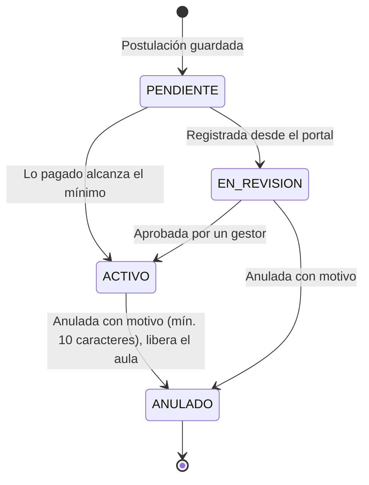

> "EN REVISIÓN" no es un estado aparte: es una inscripción PENDIENTE marcada para revisión. En el listado aparece con su propia etiqueta y el aviso **En revisión (N)** con el botón **Ver solo en revisión**.

### 10.2. Pago (detalle del banco o manual)

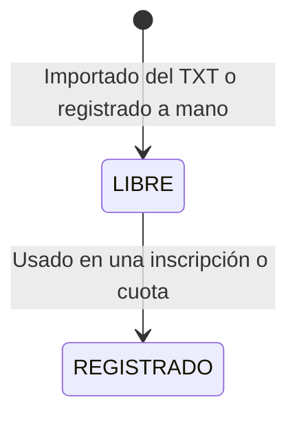

### 10.3. Obligación de pago

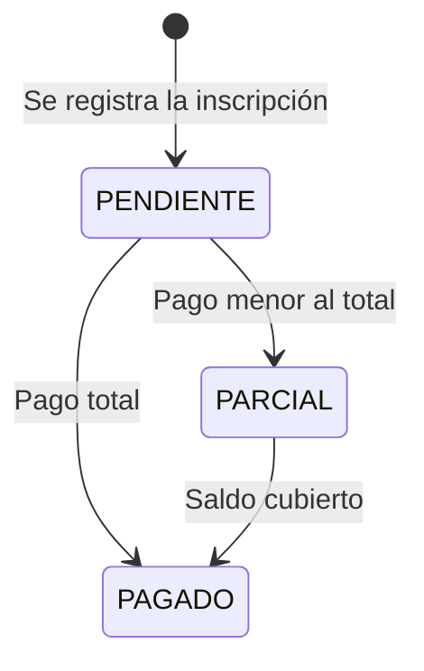

### 10.4. Proceso

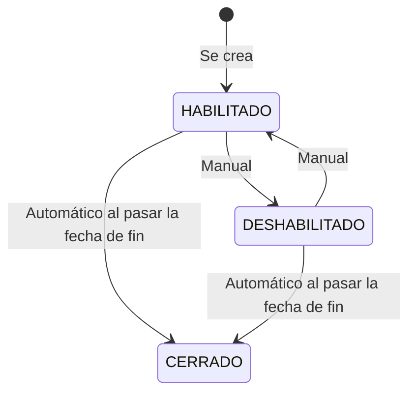

### 10.5. Resumen de estados

| Entidad | Estados |
|---|---|
| Inscripción | PENDIENTE (o EN REVISIÓN) · ACTIVO · ANULADO |
| Pago | LIBRE · REGISTRADO (internamente PENDIENTE · ASOCIADO · OBSERVADO) |
| Obligación de pago | PENDIENTE · PARCIAL · PAGADO · EXONERADO · ANULADO |
| Validación de pago | PENDIENTE · VERIFICADO · RECHAZADO |
| Proceso | HABILITADO · DESHABILITADO · CERRADO |

---

## 11. Reglas automáticas que conviene conocer

1. **Cierre de procesos:** los procesos cuya fecha de fin ya pasó se marcan como `CERRADO` automáticamente.
2. **Modalidad por año de egreso:** si el proceso no define el año máximo para ORDINARIO, se usa el año anterior al de inicio del proceso.
3. **Código de inscripción:** dos últimos dígitos del año + número de periodo (tomados del nombre del proceso) + correlativo de 4 dígitos. Por ejemplo, la primera del proceso `2026-II` es `2620001`. Las inscripciones eliminadas cuentan, para no reutilizar códigos.
4. **Capacidad de aulas:** se cuentan todas las inscripciones no anuladas del aula; al anular, el cupo se libera.
5. **Vigencias:** las reglas de pago se validan contra la fecha del día.
6. **Recaudación:** lo esperado es la suma de las obligaciones de las inscripciones no anuladas; lo recaudado, la suma de sus pagos verificados.
7. **Ubigeo:** al abrir el buscador de ubigeo sin escribir se ofrecen los distritos de Ucayali, y al buscar, Ucayali aparece primero.
8. **Exportación para Admisión y el Drive:** el Excel con el formato CEPRE empieza con `NRO_REG` (código de inscripción) y `FECHA_Y_HORA`, en orden de registro, como la hoja `DATA CEPRE-UNU` del Drive. Usa los códigos de Admisión del proceso cuando están registrados; si no, muestra los nombres de la sede y la carrera.
9. **Sincronización con el Drive:** cada 10 minutos (y con el botón `Drive` del listado) el sistema reescribe las hojas `DATA CEPRE-UNU {periodo}` y `PAGOS {periodo}` del Drive de CEPRE UNU virtual mediante un Apps Script. Así el buscador de estudiantes muestra el aula al día aunque el sistema solo funcione en la red local.
10. **Edición de la postulación:** sede, carrera o turno se cambian con confirmación y motivo; si cambia el turno se reasigna el aula. Cada cambio queda en el historial de la inscripción.
11. **Modalidad:** se sugiere por el año de egreso; el personal puede elegir otra habilitada y solo se ofrecen las carreras de esa sede y modalidad. En el portal siempre es la sugerida.
12. **Pagos faltantes del TXT:** los que `Asociar pendientes` no asocia por DNI se asocian a mano desde el detalle de la importación; si el DNI del pago es otro, se exige un motivo que queda en la validación.
13. **Foto en el asistente:** desde el paso 2 la ficha lateral muestra la foto registrada para el DNI (o permite subirla, solo al personal).

---

## 12. Observaciones pendientes

| # | Observación | Impacto | Sugerencia |
|---|---|---|---|
| 1 | `.env.example` usa `SESSION_DRIVER=database` y `CACHE_STORE=database`, pero no existen migraciones para las tablas `sessions` ni `cache`. | Una instalación hecha desde `.env.example` da error 500. `.env.red-local.example` usa `file` y no tiene el problema. | Crear las migraciones o cambiar el ejemplo a `file`. |
| 2 | Solo se pueden anular inscripciones ACTIVAS o en revisión. | Una inscripción PENDIENTE hecha por el personal, que no llegó al mínimo, ocupa aula hasta completarse. | Permitir anularlas o liberar su aula al cerrar el proceso. |
| 3 | El estado `EXONERADO` de la obligación de pago existe pero ningún flujo lo asigna; las modalidades gratuitas (Parentesco UNU) usan una regla de S/ 0. | Ninguno por ahora. | Retirarlo o usarlo para las reglas de S/ 0. |
